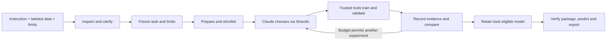

# GoTrain presentation rehearsal brief

Practice material for [5.2](https://github.com/Hsenabbass/GoTrain/issues/24),
2026-11-01. This is background for rehearsal; **5.3 selects the final story** for
3–5 minutes including video. Product claims use completed M4 at `88b5bf9`, with
runtime and model revisions preserved in the linked evidence. UI polish and final
screenshots belong to 5.1. Detailed numbers and figures: [results](m5-results.md).

## The problem and goal

Turning labeled satellite or aerial images into a usable model involves many
connected steps: understanding the data, choosing a recipe, running experiments,
checking results and packaging the selected model. GoTrain automates this bounded
workflow and keeps the evidence explaining its choices. Its goal is a useful
model and an understandable experiment history, within the user's limits.
[Direction](PROJECT_PLAN.md#goals-and-direction)

## What goes in and what comes out

The user supplies a task description, a supported labeled dataset and limits on
time, GPU work, attempts and model requests. GoTrain returns validation results,
a selected model package, a prediction entry point and a recorded history that
can be inspected and downloaded. The package preserves weights, architecture,
preprocessing, channels, classes, dependencies and originating run/version.
[Request contract](service.md) · [Model packages](prediction.md)

## How general is it?

Image classification assigns one class to an image, such as land cover or kiln
presence; semantic segmentation assigns a class to every pixel, such as solar
panels or land-cover regions. A common manifest adapter connects explicitly
labeled training/validation data to both workflows; four GEO-Bench tasks and two
synthetic custom task types were demonstrated. Imports require supported image
formats, metadata, class labels or masks, and explicit splits: arbitrary ZIPs,
unlabeled tasks, automatic tiling and reprojection are outside the delivered
contract. [Data](data.md) · [Import contract](service.md#dataset-contract) ·
[M4 acceptance](m4-evidence.json)

## The pipeline

Inspect the request/data, ask necessary questions, then freeze the agreed task and
limits. Prepare inputs, shortlist reviewed recipes, run bounded experiments,
validate and keep the best eligible model; verify its package before exposing
prediction and download. This draft schema is content for later design, not a
fixed slide layout. [Service lifecycle](service.md) · [Bounded search](training.md)

## Who decides, and who executes?

Claude proposes experiments and interprets returned evidence. Strands connects
those decisions to typed tools, while trusted software runs training/scoring and
enforces allowed actions, budgets and selection rules. In M2, lowering EuroSAT's
learning rate from 0.01 to 0.003 produced 86.20% validation accuracy versus the
87.00% reference; trusted selection retained the prior best. This shows that an
agent can finish a useful comparison even when its idea loses.
[M2 decision evidence](milestones/m2-engine.md#results-and-limitations) ·
[Recorded cycle](m2-evidence.json)

## The user's workflow

Attach a supported dataset or name a prepared benchmark, describe the goal and
answer clarification questions. Review the proposed task/limits, start it, follow
durable progress, then try a compatible prediction, inspect model history and
download the verified package. Refresh reconnects to the saved job; Stop takes
effect after the current experiment. These behaviors were exercised in M4;
final screenshots and demo footage come from 5.1/5.3.
[Service](service.md) · [Workspace](../ui/README.md) · [M4 closure checks](m4-evidence.json)

## A few technical ideas to explain

A training recipe specifies the model and how it learns; pretrained recipes start
with reviewed existing weights, while a checkpoint saves learned parameters.
M1 references started randomly; M3 selected ImageNet-pretrained models, with
other recipe changes too. Consistent channel order, scaling and normalization are
part of the pipeline, especially for multispectral inputs.
[Reference recipes](references.md) · [Training](training.md) · [Data contracts](data.md)

Training data fits parameters; validation data guides selection; the held-out test
split is reserved for a final evaluation. Classification uses accuracy (correct
images divided by images); segmentation uses macro IoU (overlap divided by union
for each class, then the frozen class aggregation), computed from the full-split
confusion matrix. Chesapeake's primary score includes all seven classes;
its target-0-ignored diagnostic is a different metric.
[Evaluation rules](data.md) · [Results and sample counts](m5-results.md)

Software limits requests, experiments and GPU-job wall time, and keeps records
outside editable experiment code. Detached jobs persist beyond a browser refresh;
interruption recovery preserves counters and completed work rather than granting
a fresh budget. This is a bounded reviewed recipe search, not unconstrained code
invention or proof of optimality. [Training controls](training.md) ·
[Recovery evidence](m3-evidence.json) · [Durable jobs](service.md)

## Organizer-required tools and actual roles

| Required tool/resource | Role and demonstrated use | Evidence |
| --- | --- | --- |
| Provided SageMaker GPU | Runs training, validation and model inference; verified T4 environment | [Setup](setup.md), [M1](m1-evidence.json), [M3](m3-evidence.json) |
| Claude Sonnet through Bedrock | Reasons about requests/experiments; verified `eu.anthropic.claude-sonnet-5-5` in `eu-central-1` | [Setup](setup.md), [M2 cycle](m2-evidence.json) |
| Strands | Agent loop connects Claude to typed inspection/training/result tools | [M2](milestones/m2-engine.md), [Training](training.md) |
| Four GEO-Bench tasks | EuroSAT and Brick-Kiln classification; PV4GER-Seg and Chesapeake segmentation, official splits | [Data](data.md), [M3 results](m3-evidence.json) |
| GitHub | Versioned source, instructions, evidence summaries and numbered delivery tasks | [Repository workflow](WORKFLOW.md), [M5 tasks](milestones/m5-submission.md) |

Supporting implementation choices are PyTorch/Torchvision for models, a FastAPI
service for requests/jobs and a browser interface for interaction. These are
implementation choices, separate from the organizer-required resources above.
[Dependencies and execution](training.md) · [Service](service.md) · [UI](../ui/README.md)

## Evidence and honest limits

All four retained M3 pipelines improve their full-validation primary score over
the frozen M1 reference; all selected checkpoints reloaded with zero score delta.
The comparison mixes random versus pretrained initialization and changed recipes,
and actual learning progress differs under time caps. It is single-seed,
provisional evidence, with failed screens and alternatives whose quality was never
measured; it establishes neither statistical significance nor a globally best
model. [Comparison, experiments and figures](m5-results.md)

M4's synthetic runs show that import, clarification, training, package publication
and prediction connect correctly; they do not establish real-world accuracy.
Official held-out scores for **all four tasks remain pending**. Public weight
redistribution permission is unresolved, so packages remain private research
artifacts. [Readiness and reliability](m5-results.md#reliability-and-readiness)

## Practice questions

- **Why an agent?** It chooses a justified next experiment and explains a keep/reject
  decision; the trusted tools handle repeatable execution. The M2 rejection is a
  concrete example. [M2](milestones/m2-engine.md#results-and-limitations)
- **Can I upload anything?** No. Supported classification/segmentation inputs need
  labels or masks, metadata and explicit splits in the documented manifest format.
  [Import contract](service.md#dataset-contract)
- **Why trust the scores?** Selection uses full official validation with frozen
  metrics, retained records and checkpoint reload checks. Validation-guided search
  still risks overfitting; the untouched final test is a separate pending step.
  [Data rules](data.md) · [Evidence](m3-evidence.json)
- **What happens at a limit or failure?** Software prevents new work beyond caps,
  retains the best verified model and records failures/charges. Resume preserves
  completed work and counters; it does not promise mid-epoch restart.
  [M3 recovery](milestones/m3-improvement.md#33-revision)
- **Did every idea improve the model?** No. M2's lower learning rate lost, Brick-Kiln
  screens failed during setup, and MobileNet quality was unmeasured. Those records
  remain visible. [Experiments](m5-results.md)
- **Is this ready for production or final submission?** It demonstrates the core
  bounded workflow. Final test scores, final presentation/video, organizer media
  requirements and redistribution terms remain readiness items; broader deployment
  and GoPilot integration are future direction. [M5 gate](milestones/m5-submission.md)
