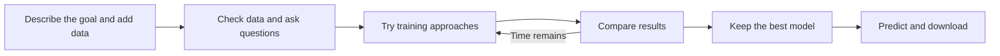

# GoTrain: presentation practice notes

Use these notes to explain the project in your own words. The final presentation
is 3–5 minutes including the demo video; 5.3 chooses what fits. The links are for
preparation, not for reading aloud. [Detailed results and charts](m5-results.md)

## What is GoTrain?

GoTrain helps turn labeled satellite and aerial images into a usable AI model.
You give it your data, explain what you want to detect, and set a time limit.
It prepares the inputs, tries training approaches, compares the results and keeps
the best model it finds within those limits.
[Project goal](PROJECT_PLAN.md#goals-and-direction)

## Why build it?

Building a model takes more than pressing Train. Someone has to understand the
data, choose an approach, check the results and decide what to try next.
GoTrain automates much of that work and saves a history explaining its choices.
[Project approach](PROJECT_PLAN.md#our-approach)

## What can it do?

It supports two types of image tasks. **Classification** gives an image one label,
such as “kiln present.” **Segmentation** marks areas inside an image, such as the
pixels containing solar panels. We demonstrated four benchmark datasets and
used small artificial datasets to check the custom-data workflow.
[Dataset descriptions](data.md) · [Workflow checks](m4-evidence.json)

Your data must already have labels, the required information about its images,
and separate training and validation sets. It supports a documented upload
format; it cannot automatically understand every ZIP file.
[Supported inputs](service.md#dataset-contract)

## How does it work?

Claude chooses what experiment to try and explains the results. Strands connects
Claude to our tools. Our software does the training, measures performance and
enforces the limits. Claude makes suggestions; recorded scores determine which
model is kept. [Training workflow](training.md) · [Service](service.md)

For example, Claude tried changing a training setting on EuroSAT. Accuracy fell
from 87.0% to 86.2%, so GoTrain kept the earlier model. A failed idea does not
mean losing the best result. [Recorded example](milestones/m2-engine.md#results-and-limitations)

## What does the user see?

Add a supported dataset, describe the task and answer any necessary questions.
Review the proposed job, start it and follow its progress. Afterwards, try a
prediction, inspect the experiment history and download the model package.
Refreshing the page reconnects to the saved job.
[User workflow](service.md) · [Interface](../ui/README.md)

## What did we achieve?

The selected models scored higher than our starting models on all four validation
datasets. EuroSAT classification accuracy rose from **87.0% to 96.6%**; the
[results note](m5-results.md) contains all four comparisons and the charts.
We also checked that saved models could be loaded again and that the custom-data
workflow could reach prediction and download. [Verification](m4-evidence.json)

These are early results from one training seed. Starting and selected models use
different training settings, including pretrained models, so we cannot credit one
change for the gains. **The four official final test scores are still pending.**
Artificial demo data checks the workflow, not real-world accuracy.
[Results and limitations](m5-results.md)

## Tools we used — backup notes

| Required tool | Simple explanation | Source |
| --- | --- | --- |
| SageMaker | The provided GPU computer where models run | [Setup](setup.md) |
| Claude Sonnet through Bedrock | The AI that chooses experiments | [Agent evidence](m2-evidence.json) |
| Strands | Connects the AI to our tools | [Agent workflow](milestones/m2-engine.md) |
| GEO-Bench | Provides EuroSAT, Brick-Kiln, PV4GER-Seg and Chesapeake | [Data](data.md) |
| GitHub | Stores our code, instructions and progress | [Workflow](WORKFLOW.md) |

We also use PyTorch for model training and a web interface for interaction.
These are supporting choices. [Training](training.md) · [Interface](../ui/README.md)

## Questions to practise — backup notes

- **Why use an agent?** To choose the next experiment based on results, instead
  of asking a person to make every training decision. [Example](m2-evidence.json)
- **Can it train on any data?** It currently supports labeled image classification
  and segmentation in our documented format. [Inputs](service.md#dataset-contract)
- **How do you check a model?** It learns from training data, and we compare models
  on separate validation data. The final test data is reserved for the end.
  [Evaluation rules](data.md)
- **What happens when time runs out?** The software stops admitting more work and
  preserves the best verified model. Progress and resource use are saved.
  [Limits and recovery](training.md)
- **What do the scores mean?** Classification accuracy measures correct image
  labels. Segmentation overlap measures how well predicted regions match the
  labeled regions. They are different metrics. [Charts](m5-results.md)
- **What remains?** Official final test scores and final presentation/demo media.
  Public sharing of model weights also needs permission; packages currently stay
  private research artifacts. [Readiness](m5-results.md#reliability-and-readiness)
