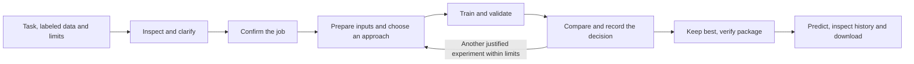

# GoTrain: pitch preparation notes

Audience: the organizers who set the challenge. Start with delivery and evidence;
they already know the problem. These notes support rehearsal and questions, rather
than a script to read in full. 5.3 selects the final story for 3–5 minutes including
the demo. [Detailed results and figures](m5-results.md)

## Open with what we delivered

“We built a working training agent connected to a chat interface. It takes a
supported labeled dataset and a task description, runs experiments within set
limits, and delivers a selected model you can use for prediction and download.
We ran the agent across all four required datasets and recorded improvements over
our starting validation results.”

The delivered workflow includes data checks, clarification, training, comparison,
saved progress, prediction, experiment history and model export. Describe these
as connected capabilities demonstrated in M4, with benchmark quality measured
separately in M1–M3. [Delivered workflow](service.md) · [Verification](m4-evidence.json)

## Explain the part the agent actually controls

Claude decides which reviewed training approach to try, reads the results and
chooses a next experiment. Strands connects those decisions to our tools. The
training software executes the experiment, measures its score and records what
happened; selection rules determine whether the new model replaces the current best.
[Agent cycle](milestones/m2-engine.md) · [Search workflow](training.md)

This separation matters when a suggestion is wrong. In our first autonomous
EuroSAT cycle, Claude reduced the learning rate from 0.01 to 0.003. Accuracy fell
from 87.0% to 86.2%, so the system rejected the change and preserved the earlier
model. We can show both the attempted change and the reason it was not kept.
[Recorded rejection](milestones/m2-engine.md#results-and-limitations)

The agent works with reviewed model choices and training settings. Its freedom is
to choose and compare experiments inside that space; time, attempts and permitted
actions are enforced by software. Avoid suggesting that it can invent and safely
run any arbitrary training program. [Controls](training.md)

## Walk through the pipeline

Before training, the system checks the dataset's structure, image channels,
labels and image–mask alignment where relevant. It asks questions if the request
is incomplete or conflicts with the data. Once the user reviews and starts the
job, the agreed task and limits are fixed. [Input checks and lifecycle](service.md)

During experiments, consistent preprocessing is part of each model's saved
pipeline. The agent compares scores on the separate validation split, rather
than deciding from training performance alone. It retains the best eligible model
and saves its settings and decision history. [Data rules](data.md) · [Training](training.md)

The exported package contains the model weights and the information needed to
use them: architecture, preprocessing, channel order, class mapping, dependencies
and a prediction entry point. We checked saved models in separate processes and
verified standalone package predictions. [Packages](prediction.md) · [Checks](m4-evidence.json)

## Show the four-task evidence

| Dataset | Metric | Starting model | Selected model | Gain |
| --- | --- | ---: | ---: | ---: |
| EuroSAT | Accuracy | 87.00% | 96.60% | +9.60 pp |
| Brick-Kiln | Accuracy | 97.80% | 98.20% | +0.40 pp |
| PV4GER-Seg | Macro IoU | 90.17% | 94.81% | +4.64 pp |
| Chesapeake | Macro IoU | 40.53% | 74.11% | +33.58 pp |

These are complete official **validation** splits. Accuracy measures correct image
labels; macro IoU measures region overlap across classes. Show the supplied
comparison chart with separate panels for the two metrics, and do not average
them into one score. Counts, exact values and run references are in the
[results note](m5-results.md).

Explain one successful search rather than reading every number. On PV4GER-Seg,
the agent screened pretrained FCN and DeepLab Mobile models: FCN scored 91.40%
macro IoU versus 85.66%. A longer final FCN run reached 94.81% and was retained.
The [decision figure](figures/m5/experiment-decision.svg) shows this progression.
[Trial and decision evidence](m3-evidence.json)

Be ready to explain the less tidy cases. Brick-Kiln's first screens failed during
setup, and their resource use stayed charged. After a fix, its ResNet screen was
below the reference; the longer final run improved on it. MobileNet was not given
a successful full quality comparison, so we cannot claim that it was worse.
[Failures and recovery](m5-results.md#what-the-experiments-show)

## Connect the demo to the engineering

Show the actual sequence: attach supported data and describe the task, answer a
clarification, review the job, then follow saved progress. Finish with a prediction,
the selected model's experiment history and a package download. Use completed
runs with clearly marked time cuts; do not imply training happened during the
short video. [Demo scope](milestones/m5-submission.md#presentation-and-video)

Point out that progress belongs to the saved job: refreshing reconnects to it,
and Stop requests an end after the current experiment. We exercised restart,
reconnect and stop behavior, along with real custom classification and
segmentation paths through training and packaging. The small artificial datasets
prove that the pieces connect; their scores are not evidence of benchmark quality.
[Service](service.md) · [Acceptance and closure checks](m4-evidence.json)

## Know what supports the claims

The required stack is in use: SageMaker runs the GPU work, Claude Sonnet through
Bedrock makes experiment decisions, Strands connects its tool calls, and the four
GEO-Bench tasks supply the benchmark data. GitHub holds the source, instructions
and delivery records. PyTorch and the web service/interface are supporting
implementation choices. [Setup](setup.md) · [Agent evidence](m2-evidence.json) ·
[Datasets](data.md) · [Repository workflow](WORKFLOW.md)

All four selected benchmark checkpoints reproduced their validation score when
loaded again. Interruption recovery preserved completed experiments, counters and
the best model. M3 used 3,459.89 charged GPU-job wall seconds, including setup,
failed work and verification; that is not pure GPU computation time. Existing
snapshots and independent checksum checks protect the saved evidence and models.
[Results/reliability summary](m5-results.md) · [Recovery receipts](RESOURCES.md)

## State the limits clearly

The improvements are from one training seed and validation-guided selection.
Starting models used random initialization; selected models used pretrained
weights and other changed settings, with different actual training progress.
We have not isolated the contribution of each change or established statistical
significance. **All four official final test scores remain pending.**
[Comparison limits and readiness](m5-results.md)

Custom data must match the documented classification or segmentation format,
including labels or masks, metadata and explicit splits. Public redistribution
permission for model weights remains unresolved, so exports stay private research
artifacts. Broader deployment and GoPilot integration remain future direction.
[Input contract](service.md#dataset-contract) · [Package limits](prediction.md) ·
[Direction](PROJECT_PLAN.md)

## Questions to rehearse

- **What is autonomous here?** Choosing experiments, interpreting their results
  and deciding what to try next within reviewed options. Software handles execution
  and enforces selection and resource rules. [Search](training.md)
- **What if Claude makes a bad choice?** The score can reject the proposed model;
  our EuroSAT learning-rate experiment did exactly that. [Example](m2-evidence.json)
- **Did pretraining cause the improvement?** It is one difference, alongside other
  recipe changes. These runs do not isolate a single cause. [Limits](m5-results.md)
- **How general is it?** The same workflow supports image classification and
  segmentation, demonstrated on four benchmarks and custom integration fixtures;
  new data must meet the supported contract. [Inputs](service.md#dataset-contract)
- **How do you prevent unlimited experimentation?** Software caps time, attempts
  and model requests, records charges and preserves counters through recovery.
  [Controls](training.md)
- **What is still unfinished?** Official final test scores and final presentation
  media; wider deployment and public weight sharing have additional unresolved
  requirements. [Readiness](m5-results.md#reliability-and-readiness)
