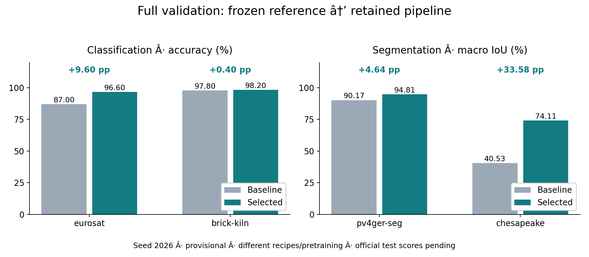
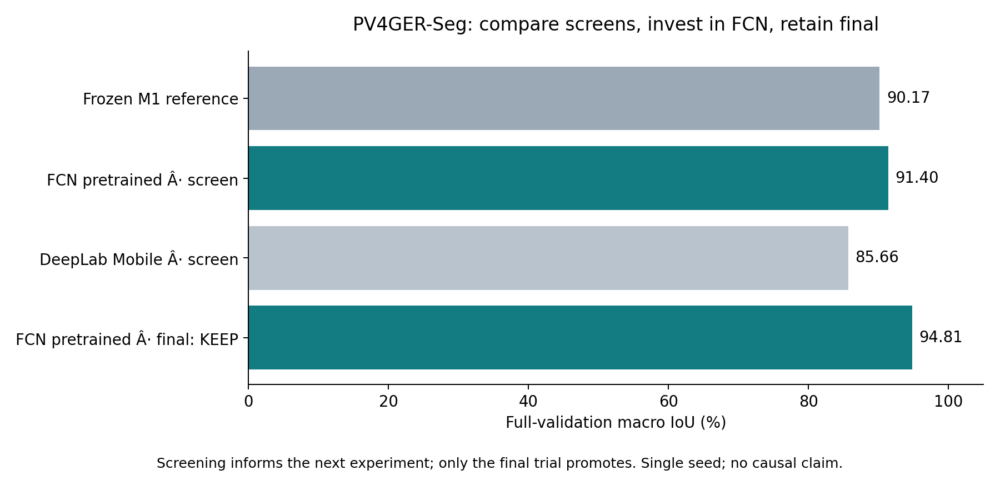

# M5 results and checks

Prepared 2026-11-01 for [5.2](https://github.com/Hsenabbass/GoTrain/issues/24).
Evidence synthesis only: no training, inference, downloads or test access in this task.
Product baseline: completed M4 `88b5bf9`; synthesis source: `fdac4c8`.
Raw JSON records remain authoritative; this document and CSV are derived views.

## Full-validation comparison

All rows use official complete validation splits, seed 2026. Values are percentages;
gain is **percentage points**, calculated before rounding. No combined score is computed.

| Task | Primary metric | M1 reference | M3 selected | Gain (pp) | Validation images / scored pixels |
| --- | --- | ---: | ---: | ---: | --- |
| [m-eurosat](m3-evidence.json) | accuracy | 87.00 | 96.60 | +9.60 | 1,000 / — |
| [m-brick-kiln](m3-evidence.json) | accuracy | 97.80 | 98.20 | +0.40 | 999 / — |
| [m-pv4ger-seg](m3-evidence.json) | macro_iou | 90.17 | 94.81 | +4.64 | 403 / 41,267,200 |
| [m-chesapeake](m3-evidence.json) | macro_iou | 40.53 | 74.11 | +33.58 | 1,000 / 65,536,000 |

Baselines: [M1 recipes/results](references.md), [M1 raw evidence](m1-evidence.json).
Selected results: [M3 raw evidence](m3-evidence.json), JSON path
`searches.results` (match `task`); each row contains reference/selected primary,
full-split counts, trials, decisions and reload receipts.

[Editable SVG](figures/m5/validation-comparison.svg) ·
[Chart-ready exact data](figures/m5/validation-comparison.csv).

### Exact run and source references

Paths below are relative to SageMaker `/home/sagemaker-user/GoTrain/artifacts/runs/`.
Use the task entry in [M3 evidence](m3-evidence.json) to resolve each run/hash;
the corresponding baseline entry is also preserved in [M1 evidence](m1-evidence.json).

- **m-eurosat**: reference `20261031T142814768185Z-m-eurosat-manual` → selected
  `20261031T170743193186Z-m-eurosat-manual`; selected training source `3c4bb0166ace570dd65f76f73e1a33cc8d514e20`.
- **m-brick-kiln**: reference `20261031T143113863281Z-m-brick-kiln-manual` → selected
  `20261031T172944640241Z-m-brick-kiln-manual`; selected training source `18785a3001dc9d761d39fe9248320ed7885c5626`.
- **m-pv4ger-seg**: reference `20261031T144800853991Z-m-pv4ger-seg-manual` → selected
  `20261031T174535869393Z-m-pv4ger-seg-manual`; selected training source `548cba035604b428244750e61f9572ba81d8e204`.
- **m-chesapeake**: reference `20261031T145719482888Z-m-chesapeake-manual` → selected
  `20261031T180108350357Z-m-chesapeake-manual`; selected training source `548cba035604b428244750e61f9572ba81d8e204`.

## What the experiments show

**Shared recipes.** M1 used random ResNet18 classifiers / FCN-ResNet50 segmenters,
SGD at 0.01, constant scheduling and training-fitted normalization. M3 finals used
ImageNet-pretrained ResNet18 / FCN-ResNet50, AdamW at 0.001, weight decay 0.0001,
cosine scheduling, backbone LR ratio 0.1 and cross-entropy. Both used train-only
augmentation. Architecture, initialization, preprocessing and optimization differ:
the gains cannot be attributed to Claude, pretraining or any single setting alone.
[Frozen recipes](references.md) · [Exact trial recipes](m3-evidence.json)

- **EuroSAT:** ResNet screen 91.00%, final 96.60%; final retained over 87.00%.
  MobileNet was only probed, so its quality is unmeasured. A duplicated probe was
  audited and charged; session-scoped IDs and pending-work guards were repaired.
- **Brick-Kiln:** initial ResNet and MobileNet screens hit the hard watchdog during
  setup, with no full score. After verified normalization reuse, ResNet screen
  scored 97.10%, below the 97.80% reference; the longer final reached 98.20% and
  was retained. MobileNet quality remains unmeasured, not demonstrated inferior.
- **PV4GER-Seg:** FCN screen 91.40% versus DeepLab Mobile 85.66% macro IoU;
  final FCN reached 94.81% and was retained over 90.17%.
- **Chesapeake:** FCN screen 67.42% versus DeepLab Mobile 60.47%; final FCN
  reached 74.11% and was retained over 40.53%. Primary scoring includes all seven
  classes, including target 0; the land-only diagnostic is not this score.

These summaries follow `trials`, `decisions` and `finish_reason` in
[M3 evidence](m3-evidence.json). Smoke probes have no eligible primary score.
Screen comparisons guide investment; only eligible final primary-seed trials promote.

[Editable decision SVG](figures/m5/experiment-decision.svg). The FCN and DeepLab
screens had the same planned 150-second ceiling; the final FCN had a 600-second
ceiling. This is a bounded comparison, not equal convergence or a causal ablation.

**A rejected idea:** M2 lowered EuroSAT LR from 0.01 to 0.003, obtaining 86.20%
versus 87.00%; selection retained the prior model. Both completed ten epochs on
the full validation split. [M2 records](m2-evidence.json) ·
[Decision interpretation](milestones/m2-engine.md#results-and-limitations)

### Actual resources and training progress

| M3 category | Charged GPU-job wall seconds |
| --- | ---: |
| shared | 222.93 |
| m-eurosat | 702.66 |
| m-brick-kiln | 1002.33 |
| m-pv4ger-seg | 748.56 |
| m-chesapeake | 783.42 |
| **Total** | **3459.89 / 7,200** |

This is charged job wall time including CPU setup, probes, failed attempts and
checkpoint verification, not pure GPU kernel time or selected-run training time.
M1 reference training separately consumed 1,846.77 seconds; M2 used 350.45 job
seconds (341.02 training, 9.43 verification). Do not describe M1→M3 as an equal-cost
ablation. Model-request counts for M3 EuroSAT/Brick-Kiln/PV4GER/Chesapeake are
24, 15, 12, 9, respectively; returned token receipts omit interrupted calls and are not complete billing.
[M1 costs](references.md) · [M2 costs](milestones/m2-engine.md#results-and-limitations) ·
[Settled M3 ledger snapshot](m3-evidence.json)

M1 completed 10/4/5/5 full epochs and 630/2,334/3,846/4,267 steps, respectively;
partial capped epochs may follow those totals. M3 allowed up to 50 epochs, 5,000
steps in these recipes, or the wall cap: equal planned caps do not imply equal
learning progress. Chesapeake records FCN/DeepLab screens at 615/720 steps with
zero full epochs, and final FCN at 4,235 steps/five full epochs. The compact M3
summary does not contain actual step/epoch totals for the other three finals;
do not invent them or infer them from the configured ceiling. Full trial records
remain in the recorded SageMaker run directories and existing recovery archives.
[M1 progress](references.md) · [M3 trials and raw-record locations](m3-evidence.json)

All results are single-seed (2026), selected using validation; no matched second-seed
confirmation fit the remaining shared allocation. No significance, retraining
stability, global optimality, geographic generalization or published-test equivalence
is established. [Confirmation limit](m3-evidence.json)

## Reliability and readiness

| Existing check | What it establishes | Evidence |
| --- | --- | --- |
| M1 four checkpoint revalidations | Fresh-process full validation reproduced all retained baselines (delta 0) | [M1 handoff](m1-evidence.json) |
| M3 four selected reloads/predictions | Full-validation delta 0; classification labels/probabilities and segmentation masks had checked output shapes | [M3 reload receipts](m3-evidence.json) |
| M3 38 SageMaker CPU checks and interruption recovery | Guards passed; counters/ledger/best preserved; completed training not replayed | [M3 checks/recovery](m3-evidence.json) |
| M4 95 SageMaker CPU checks, 17 focused stop checks; six standalone packages | Packaging, isolated CPU parity and durable job behavior at the recorded revisions | [M4 acceptance](m4-evidence.json) |
| M4 synthetic classification and segmentation | Real import→clarification→bounded train→validate→package; initial pair used 62.74 job seconds; integration only | [M4 acceptance](m4-evidence.json) |
| M4 follow-up 17 SageMaker request checks, six local JS fixtures and live browser checks | Late attachment, saved history, reconnect and Start-ID safeguards; mocked network failures are not live fault injection | [M4 closure checks](m4-evidence.json) |
| Independent snapshots and checkpoint restoration | Sender/receiver/member checksums and opaque checkpoint restores verified | [Resources](RESOURCES.md), [M3](m3-evidence.json), [M4](m4-evidence.json) |

These checks belong to their recorded historical revisions, not the pending 5.1
UI changes. Tiny prediction outputs and synthetic validation are not benchmark
scores. No concrete saved-model gap remains for 5.2, so no additional smoke run
was made; no new GPU, Bedrock or inference resources were charged.

**Required official held-out scores: pending for EuroSAT, Brick-Kiln, PV4GER-Seg
and Chesapeake.** No test split was accessed for 5.2, and no subset/synthetic result
replaces this requirement. Submission remains incomplete until required final
scores/logs and final media are delivered or organizers explicitly change the gate.
Public weight redistribution permission and organizer media format also remain
unresolved. [M5 submission gate](milestones/m5-submission.md#decisions-and-open-questions)

## Handoff assets and reproduction

5.3 receives the [rehearsal brief and draft pipeline schema](m5-presentation-brief.md),
this results/reliability note, exact CSV, and PNG/SVG comparison/decision figures.
Final content selection, polished UI screenshots, slides and video belong to 5.3
(screenshots supplied by 5.1). Regenerate only the derived assets locally with
`python scripts/presentation_figures.py` using matplotlib; this reads committed
JSON and performs no agent, training or inference execution. All new artifacts are
small tracked source/assets; GitHub synchronization provides their recovery copy
under the [storage policy](storage.md). No new untracked run evidence or model
artifact was produced, so no new SageMaker snapshot/transfer is needed.
